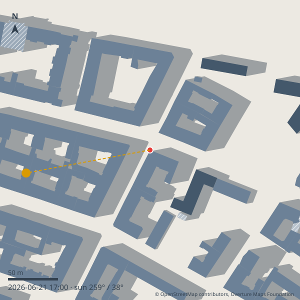

# Sunspots

Is the café terrace, balcony or bench **in direct sun right now**, when does that change, and
how much sun will it get today? Sunspots answers this in Home Assistant from public building data
and the position of the sun. No account, no cloud service: everything is calculated and stored
in your own Home Assistant.

> **Status: 1.0.0 candidate (pre-release).** Sun/shade geometry, the cloud-aware forecast, the shadow map and the
> dashboard card work; accuracy has not been validated against real observations yet. Accuracy depends on how well your area is mapped,
> see [Accuracy](#accuracy).

## Install

1. HACS → ⋮ → *Custom repositories* → add `https://github.com/enra64/sunspots` as *Integration*.
2. Install **Sunspots**, restart Home Assistant (needs Home Assistant 2026.10 or newer).
3. *Settings → Devices & services → Add integration → Sunspots*, and accept or change the shared
   settings (search radius, observer height, default weather entity).
4. On the Sunspots entry choose **Add spot**: name it, pick the exact location on the map
   (the table, not the building), wait a few seconds while building data is downloaded once.

## What you get

Per spot (one device each):

| Entity | Meaning |
|---|---|
| `binary_sensor.<spot>_sunny` | Direct sun reaches the spot (buildings only). Attributes: sun azimuth/elevation, skyline elevation at the sun, today's sunny intervals. |
| `binary_sensor.<spot>_sunny_weather_aware` | Same, and the current cloud cover is within your limit (default 40 %). Only if a weather entity is set. |
| `sensor.<spot>_next_change` | When the spot flips between sunny and shaded. |
| `sensor.<spot>_sun_remaining` | Minutes of continuous sun left (0 when shaded). |
| `sensor.<spot>_sun_hours_today` | Sunny hours for today (buildings only, local midnight to midnight). |
| `sensor.<spot>_sun_forecast` | Rest of today: *sunny now*, *partly sunny now*, *sunny later*, *partly sunny later*, *no sun today*. Attributes: `windows` (sunny / partly / unlikely, with `past`), `best_window`, `hourly`, `forecast_available`, `forecast_resolution`. |
| `image.<spot>_shadow_map` | Top-down picture of the buildings and shadows now (SVG). |
| `sensor.<spot>_data_quality` | Disabled by default. Share of the skyline with measured building heights, sources, release. |

Hub: `sensor.sunspots_sunny_spots` counts sunny spots (weather-aware where configured); its `next_window` attribute names the next sunny window across all spots.

**Actions** (target a spot's `_sunny` entity): `sunspots.get_sun_forecast` (sunlit intervals for a
day, returns a response), `sunspots.refresh_buildings`, `sunspots.set_building_height`,
`sunspots.calibrate`, `sunspots.render_shadow_map` (returns an SVG for any time).

Dashboards ("Now", "Today", morning notification) are in [docs/dashboards](docs/dashboards/README.md); which weather integrations work is in [docs/weather-providers.md](docs/weather-providers.md).

### The card and the shadow view

The integration ships `custom:sunspots-card` (no separate install). Modes: `overview`, `timeline`, `map`
(shadow picture with a time slider). See [docs/card.md](docs/card.md).

Colours show where a building's height comes from (blue-grey = measured, hatched = guessed from type or
a default, green = set by you); the dashed line points to the sun.

### Weather and forecast

Set a weather entity in the shared settings (or per spot). Sunspots uses the entity's
`cloud_coverage` attribute if it has one, otherwise its condition (sunny/clear-night = 0 %,
partly cloudy = 40 %, cloudy = 90 %, fog/rain/snow/lightning = 100 %; other conditions are
treated as unknown and the sensor then follows the geometry). The weather-aware sensor turns off
when cloud cover exceeds the limit plus 5 points and holds each state for at least 5 minutes.
The forecast uses hourly data when your weather entity has it, otherwise daily, otherwise only the geometry. Cloud percentage is only a rough stand-in for direct sun.

## How it updates

Nothing is polled. The sun position and your skyline are computed locally; each spot recomputes a
two-day timeline at local midnight, when you change something, and as a safety net every five minutes, and
schedules its state changes for the exact moments the sun appears or disappears. The *sun remaining* and
attributes refresh once a minute. Building data is downloaded when you add a spot or ask for a refresh and
about every 90 days; Home Assistant starts offline from the cache. The weather forecast is read every 30
minutes.

## Examples

Automations, a script reading the daily windows and dashboards: [docs/examples.md](docs/examples.md),
[docs/dashboards](docs/dashboards/README.md).

## Fixing wrong results

Open the spot → *Reconfigure*:

- **Settings**: location, radius, observer height, **ground offset** (a raised terrace or slope), weather entity.
- **Corrections**: set a building's real height, add an obstacle (tree, mast) between two compass
  directions, or delete earlier corrections.
- **Refresh building data**: download again (also done automatically about every 90 days).

`sunspots.calibrate` tells the model what you see: if it disagrees, it adds a small correction
(±3° around the sun's direction, stored with date and note, deletable).

## Accuracy

Sunspots treats the ground as flat and every building as a box. Building heights are the main
uncertainty: where heights are missing it falls back to floors, building type and finally a
default. A repair issue appears when a spot has mostly guessed heights. See
[docs/accuracy.md](docs/accuracy.md) for limits and how to measure agreement with
`tools/score_observations.py`. No validation numbers exist yet.

## Known limitations and troubleshooting

- **A spot is always shaded / sunny when it should not be**: check the pin is on the table, not on a facade
  (the *Data quality* sensor and `docs/accuracy.md` explain what the model cannot see), then use *Corrections*.
- **"Some spots have mostly guessed building heights" repair**: the area has few measured heights; set the
  heights of the tallest nearby buildings under *Reconfigure → Corrections*.
- **"Building data could not be loaded"**: Overture's tile service is experimental. Sunspots keeps the cached
  data; retry later with `sunspots.refresh_buildings` or allow Overpass in the settings.
- **Weather-aware sensor never turns on**: check the weather entity (and its `cloud_coverage` or condition);
  the limit is in the settings.
- Not modelled: trees, awnings, terrain slopes, roof shapes, clouds beyond your weather entity's value.
- Other time zones: "today" always follows Home Assistant's time zone.

## Privacy and data

No telemetry, no server operated by the maintainer. Default data source is Overture Maps' public
tiles (they see tile numbers, not your spot). **Overpass is off by default**; if you turn it on it
receives the spot's exact coordinates. Details: [docs/privacy.md](docs/privacy.md).

Building data: © OpenStreetMap contributors, Overture Maps Foundation (ODbL). Overture describes
its tile service as not production-ready; if it fails Sunspots keeps working from cached data and
raises a repair issue.

## Uninstall

Remove the Sunspots integration entry (this deletes all spots, their stored data and the tile
cache from `.storage`), then remove it in HACS. Nothing else is left behind.

## Tools

`tools/bench.py` (speed of the shading calculation on your hardware),
`tools/score_observations.py` (compare your observations with the model),
`tools/probe_pmtiles.py` (check Overture tile coverage for a location).

## Licence

Code: Apache-2.0 (see `LICENSE` and `NOTICE`). Test fixtures contain ODbL data and have their own
licence file in `tests/fixtures/`.
